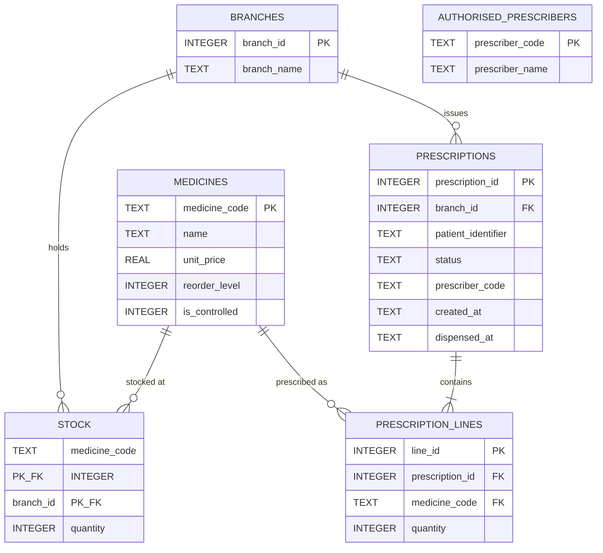

# Database Design

UCU Campus Pharmacy Management System
Multi-Branch Campus Pharmacy Inventory, Dispensing and Reporting System
Course: CSC2105 - Object-Oriented Programming Using Python
Owner: Member 5 (database development, repositories, selected services, testing coordination, documentation)

This document is the single database contract for the group. All members must follow the table names, column names, data types and constraints defined here. No database code or schema file has been implemented yet; this is a design document only.

---

## 1. Purpose

This database stores medicines, branches, branch-specific stock, prescriptions, prescription lines and the simulated authorised prescriber allow-list. It supports atomic dispensing, stock tracking and low-stock reporting across multiple campus branches.

---

## 2. Required system rules

1. Each medicine has a unique code, name, positive unit price and nonnegative integer reorder level.
2. Medicines may be ordinary or controlled.
3. A branch has its own stock quantity for each medicine.
4. Stock quantity must never be negative.
5. A prescription belongs to one branch and has a fictional patient identifier.
6. A prescription contains one or more medicine lines, each with a medicine code and positive quantity.
7. Prescription statuses are pending, dispensed and cancelled.
8. Controlled medicines can only be dispensed when the prescriber code exists in the simulated authorised prescribers list.
9. Ordinary medicines do not require the prescriber allow-list check.
10. Dispensing must be atomic: if any medicine line fails, all stock changes must roll back and the prescription must remain pending.
11. A dispensed prescription cannot be dispensed again.
12. A cancelled prescription cannot be dispensed.
13. Low stock means quantity is less than or equal to the medicine's reorder level, for a particular branch.

---

## 3. Table designs

### 3.1 `medicines`

Stores the catalogue of medicines. No strength or form fields are required by the system rules; optional descriptive attributes may be added later only if the group agrees.

| Column | SQLite type | Primary key | Foreign key | NOT NULL | UNIQUE | CHECK | Default |
|---|---|---|---|---|---|---|---|
| `medicine_code` | TEXT | Yes | No | Yes | Yes | - | - |
| `name` | TEXT | No | No | Yes | No | - | - |
| `unit_price` | REAL | No | No | Yes | No | `unit_price > 0` | - |
| `reorder_level` | INTEGER | No | No | Yes | No | `reorder_level >= 0` | `0` |
| `is_controlled` | INTEGER | No | No | Yes | No | `is_controlled IN (0, 1)` | `0` |

Notes:
- `medicine_code` is the natural primary key (e.g. "MED-001").
- `is_controlled` uses SQLite's boolean representation: 0 = ordinary, 1 = controlled.
- Only `medicine_code`, `name`, `unit_price`, `reorder_level` and `is_controlled` are required. Extra fields are not permitted unless agreed.

### 3.2 `branches`

Stores campus pharmacy branches. Uses an integer surrogate primary key.

| Column | SQLite type | Primary key | Foreign key | NOT NULL | UNIQUE | CHECK | Default |
|---|---|---|---|---|---|---|---|
| `branch_id` | INTEGER | Yes (AUTOINCREMENT) | No | Yes | Yes (implicit) | - | - |
| `branch_name` | TEXT | No | No | Yes | Yes | - | - |

Notes:
- `branch_id` is a surrogate integer primary key.
- `branch_name` must be unique to avoid duplicate branches.

### 3.3 `stock`

Stores the quantity of each medicine at each branch. Composite primary key ensures one row per medicine per branch.

| Column | SQLite type | Primary key | Foreign key | NOT NULL | UNIQUE | CHECK | Default |
|---|---|---|---|---|---|---|---|
| `medicine_code` | TEXT | Yes (composite) | Yes -> medicines(medicine_code) | Yes | No (part of PK) | - | - |
| `branch_id` | INTEGER | Yes (composite) | Yes -> branches(branch_id) | Yes | No (part of PK) | - | - |
| `quantity` | INTEGER | No | No | Yes | No | `quantity >= 0` | `0` |

Foreign key rules:
- `medicine_code` REFERENCES `medicines(medicine_code)` ON UPDATE CASCADE ON DELETE RESTRICT
- `branch_id` REFERENCES `branches(branch_id)` ON UPDATE CASCADE ON DELETE RESTRICT

Notes:
- A missing stock row means the branch currently has zero units of that medicine.
- Negative quantities are impossible at the database level.

### 3.4 `prescriptions`

Stores a prescription header. A prescription belongs to one branch and one fictional patient. The prescriber code is captured at creation time; it may be NULL for ordinary prescriptions, but must be a valid authorised prescriber code before dispensing any controlled medicine.

| Column | SQLite type | Primary key | Foreign key | NOT NULL | UNIQUE | CHECK | Default |
|---|---|---|---|---|---|---|---|
| `prescription_id` | INTEGER | Yes (AUTOINCREMENT) | No | Yes | Yes (implicit) | - | - |
| `branch_id` | INTEGER | No | Yes -> branches(branch_id) | Yes | No | - | - |
| `patient_identifier` | TEXT | No | No | Yes | No | - | - |
| `status` | TEXT | No | No | Yes | No | `status IN ('pending', 'dispensed', 'cancelled')` | `'pending'` |
| `prescriber_code` | TEXT | No | No | No | No | - | NULL |
| `created_at` | TEXT | No | No | Yes | No | - | `datetime('now')` |
| `dispensed_at` | TEXT | No | No | No | No | - | NULL |

Foreign key rules:
- `branch_id` REFERENCES `branches(branch_id)` ON UPDATE CASCADE ON DELETE RESTRICT

Notes:
- `patient_identifier` is a fictional identifier only (no real patient data).
- `prescriber_code` is captured when the prescription is created. It may be NULL for ordinary prescriptions. It is not a foreign key to `authorised_prescribers` (so ordinary prescriptions are not forced to carry an authorised code), but the prescription service must ensure that any non-null code is authorised and that a valid authorised code is present before dispensing a controlled medicine.
- `status` is restricted to the three permitted values.

### 3.5 `prescription_lines`

Stores the medicine lines of a prescription. Duplicate medicine lines on the same prescription are prevented.

| Column | SQLite type | Primary key | Foreign key | NOT NULL | UNIQUE | CHECK | Default |
|---|---|---|---|---|---|---|---|
| `line_id` | INTEGER | Yes (AUTOINCREMENT) | No | Yes | Yes (implicit) | - | - |
| `prescription_id` | INTEGER | No | Yes -> prescriptions(prescription_id) | Yes | No | - | - |
| `medicine_code` | TEXT | No | Yes -> medicines(medicine_code) | Yes | No | - | - |
| `quantity` | INTEGER | No | No | Yes | No | `quantity > 0` | - |

Constraints:
- UNIQUE (`prescription_id`, `medicine_code`) - prevents the same medicine appearing twice on one prescription.

Foreign key rules:
- `prescription_id` REFERENCES `prescriptions(prescription_id)` ON UPDATE CASCADE ON DELETE CASCADE
- `medicine_code` REFERENCES `medicines(medicine_code)` ON UPDATE CASCADE ON DELETE RESTRICT

Notes:
- Each line references an existing prescription and an existing medicine.
- Quantities are strictly positive integers.
- Deleting a prescription cascades to its lines.

### 3.6 `authorised_prescribers`

Simulated allow-list of prescriber codes that may authorise controlled medicines.

| Column | SQLite type | Primary key | Foreign key | NOT NULL | UNIQUE | CHECK | Default |
|---|---|---|---|---|---|---|---|
| `prescriber_code` | TEXT | Yes | No | Yes | Yes | - | - |
| `prescriber_name` | TEXT | No | No | No | No | - | NULL |

Notes:
- Existence of a row for a code means the prescriber is authorised.
- `prescriber_name` is optional display text.

---

## 4. Important design decisions

1. **Composite primary key on `stock`** (medicine_code, branch_id): the same medicine can have separate quantities at different branches.
2. **Integer branch key:** `branches.branch_id` is an INTEGER surrogate primary key.
3. **Boolean representation:** `medicines.is_controlled` is stored as INTEGER 0/1 with a CHECK constraint, matching SQLite's convention.
4. **Status restriction:** `prescriptions.status` is constrained to 'pending', 'dispensed' and 'cancelled'.
5. **Positive quantities:** `prescription_lines.quantity > 0`; `medicines.unit_price > 0`; `medicines.reorder_level >= 0`; `stock.quantity >= 0`.
6. **Foreign keys:** all cross-table references use foreign keys. Repositories must enable them with `PRAGMA foreign_keys = ON` on every connection.
7. **Prescriber code captured at creation:** `prescriptions.prescriber_code` may be NULL for ordinary prescriptions; controlled medicines require a valid authorised code before dispensing.
8. **Duplicate line prevention:** UNIQUE (prescription_id, medicine_code) prevents duplicate medicine lines.
9. **Timestamps retained:** `created_at` and `dispensed_at` are kept.
10. **No mandatory strength/form:** strength and form are not required medicine fields.
11. **Restricted deletion:** medicines and branches that are referenced cannot be deleted (ON DELETE RESTRICT). Dispensed prescriptions cannot be deleted to preserve history.
12. **Cascade on prescription deletion:** deleting a pending or cancelled prescription deletes its lines (ON DELETE CASCADE).
13. **Parameterised SQL only:** all repositories must use parameterised queries; string concatenation of SQL is forbidden.
14. **No unnecessary fields:** only required medicine fields are included.
15. **Missing stock row = zero quantity:** a branch with no stock row for a medicine is treated as having zero units.

---

## 5. Service-level integrity rules (enforced by services, not DB constraints)

1. A prescription must contain at least one prescription line.
2. Status transitions: pending -> dispensed or pending -> cancelled only. A dispensed or cancelled prescription cannot be dispensed.
3. If any prescription line references a controlled medicine, `prescriber_code` must be non-null and must exist in `authorised_prescribers`.
4. Ordinary medicines do not require the prescriber allow-list check.
5. Dispensing must verify available stock for every line before deducting anything.
6. Stock deduction and status update happen in one transaction.
7. Prescription creation must reject an empty list of medicine lines; this validation belongs in the prescription service.
8. Dispensed prescriptions must not be deleted, so their history is preserved. Only pending or cancelled prescriptions may be deleted, with cascade to their lines.

---

## 6. Table relationships

- A **medicine** can appear in many **stock** rows (one per branch) and many **prescription_lines**.
- A **branch** can have many **stock** rows (one per medicine) and many **prescriptions**.
- A **prescription** belongs to exactly one **branch** and has one or more **prescription_lines**.
- A **prescription_line** references exactly one **prescription** and one **medicine**.
- An authorised prescriber code is checked (by existence in `authorised_prescribers`) by the prescription service when dispensing controlled medicines.

Cardinality summary:
- medicines 1..* stock
- branches 1..* stock
- branches 1..* prescriptions
- prescriptions 1..* prescription_lines
- medicines 1..* prescription_lines

---

## 7. ER diagram (Mermaid)



---

## 8. Example queries

### 8.1 View stock at a particular branch

```sql
SELECT m.medicine_code,
       m.name,
       m.is_controlled,
       s.quantity,
       m.reorder_level
FROM stock AS s
JOIN medicines AS m ON m.medicine_code = s.medicine_code
WHERE s.branch_id = ?;
```

Parameter: branch_id.

### 8.2 Identify low-stock medicines at a branch

Low stock means quantity is less than or equal to the medicine's reorder level.

```sql
SELECT m.medicine_code,
       m.name,
       s.quantity,
       m.reorder_level
FROM stock AS s
JOIN medicines AS m ON m.medicine_code = s.medicine_code
WHERE s.branch_id = ?
  AND s.quantity <= m.reorder_level
ORDER BY s.quantity ASC, m.name ASC;
```

Parameter: branch_id.

To also include medicines with no stock row (treated as zero):

```sql
SELECT m.medicine_code,
       m.name,
       COALESCE(s.quantity, 0) AS quantity,
       m.reorder_level
FROM medicines AS m
LEFT JOIN stock AS s
  ON s.medicine_code = m.medicine_code
 AND s.branch_id = ?
WHERE COALESCE(s.quantity, 0) <= m.reorder_level
ORDER BY quantity ASC, m.name ASC;
```

---

## 9. Missing stock record treatment

A missing row in `stock` for a (medicine, branch) pair means the branch currently holds zero units of that medicine. Repositories must handle this by:
- Treating absence as quantity 0 in read queries (use LEFT JOIN with COALESCE(quantity, 0)).
- Creating a stock row with quantity 0 when first receiving stock at a branch, or inserting on first receipt.
- Never assuming a stock row exists before dispensing; the dispensing transaction must check available quantity as COALESCE(quantity, 0).

---

## 10. Dispensing transaction

Dispensing must be atomic and controlled by the prescription service. Steps:

1. Begin a transaction (`BEGIN IMMEDIATE`).
2. Load the prescription and its lines.
3. Validate:
   - Prescription exists.
   - Status is 'pending' (not 'dispensed' or 'cancelled').
   - Branch exists.
4. For each prescription line:
   - Load the medicine.
   - If the medicine is controlled, check that `prescriber_code` is non-null and exists in `authorised_prescribers`; if not, abort.
   - Check available stock at the prescription's branch: COALESCE(quantity, 0) >= line quantity; if not, abort.
5. If all checks pass, deduct stock for every line (UPDATE stock SET quantity = quantity - ? WHERE medicine_code = ? AND branch_id = ?).
6. Update the prescription with a conditional status change: `UPDATE prescriptions SET status = 'dispensed', dispensed_at = ? WHERE prescription_id = ? AND status = 'pending'`. Check that exactly one row was updated; if zero rows were updated, abort (the prescription was already dispensed or cancelled).
7. Commit. On any failure, ROLLBACK and leave the prescription 'pending'.

All repository calls inside this flow must accept and use the same connection/transaction. The service owns the transaction boundary (BEGIN/commit/rollback). Repositories must not commit or rollback themselves.

A dispensed prescription cannot be dispensed again because status is no longer 'pending'. A cancelled prescription cannot be dispensed for the same reason.

---

## 11. Integration contract

### Member 2 (domain: medicine, branch, stock)
- Domain classes must match database fields:
  - Medicine: code, name, unit_price, reorder_level, is_controlled (bool).
  - Branch: branch_id, branch_name.
  - Stock: medicine_code, branch_id, quantity.
- Domain classes must not import tkinter or create database connections.
- Validation (positive price, nonnegative reorder level, nonnegative quantity) should mirror CHECK constraints.

### Member 3 (domain: prescription, prescription line)
- Prescription: prescription_id, branch_id, patient_identifier, status, prescriber_code, created_at, dispensed_at.
- PrescriptionLine: line_id, prescription_id, medicine_code, quantity.
- Status values: pending, dispensed, cancelled.
- Quantity strictly positive.
- prescriber_code is captured at creation and may be NULL for ordinary prescriptions.

### Services (all members)
- Services coordinate business rules and call repositories; they must not execute SQL directly.
- Repositories handle parameterised SQL and persistence.

### Repositories (Member 5)
- Each repository method accepts an optional shared connection/transaction handle.
- Repositories must not commit or rollback; the calling service owns the transaction.
- All SQL must be parameterised.

### Prescription service (atomic dispensing)
- Owns the transaction boundary for dispensing.
- Uses repositories for all data access.
- Enforces controlled-medicine prescriber allow-list check.
- Enforces status transition and at-least-one-line rules.

### GUI (all members)
- GUI screens communicate through application services only.
- No GUI code may import sqlite3 or execute SQL.

### Application services (app layer)
- Wire GUI to services; provide shared service instances.
- Do not bypass services to reach repositories.

---

## 12. Assumptions

1. Branches are identified by an integer `branch_id` (surrogate key), as decided.
2. `prescriber_code` is captured at prescription creation and may be NULL for ordinary prescriptions; controlled medicines require a valid authorised code before dispensing, enforced by the service.
3. `created_at` and `dispensed_at` are stored as TEXT in ISO-8601 form using SQLite `datetime('now')`.
4. Optional medicine attributes (strength, form, etc.) are not included; they can be added later by group agreement.
5. No separate users/roles table is included; prescriber authorisation is simulated via `authorised_prescribers`.
6. Foreign keys are enforced by enabling `PRAGMA foreign_keys = ON` on every connection.
7. Prescriber code is not a foreign key to `authorised_prescribers`, so ordinary prescriptions are not forced to carry an authorised code; validity is enforced by the service for controlled medicines.

---

## 13. Decisions confirmed by group standard

1. Integer `branch_id` is the branch primary key.
2. `prescriber_code` is captured when creating a prescription; may be NULL for ordinary prescriptions; controlled medicines require a valid authorised prescriber before dispensing.
3. Duplicate medicine lines are prevented via UNIQUE (prescription_id, medicine_code).
4. `created_at` and `dispensed_at` timestamps are retained.
5. No mandatory medicine strength or form fields.
6. Deletion of medicines and branches referenced by other records is restricted.
7. Prescription lines cascade when their parent prescription is deleted.
8. Standardise on Python 3.13.x.
9. Enable SQLite foreign-key enforcement on every database connection.

---

## 14. Identified gaps and service-level constraints

1. **At least one line per prescription** cannot be enforced by a table constraint; the prescription service must reject empty prescriptions.
2. **Status transitions** (pending -> dispensed/cancelled) are enforced by the service, not by CHECK constraints.
3. **Controlled-medicine prescriber authorisation** is enforced by the service because `prescriber_code` is nullable and not a foreign key.
4. **Prescription deletion cascading to lines** may remove historical detail; if history must be preserved, the service should prevent deletion of dispensed prescriptions.
5. **No database-level trigger** prevents dispensing a cancelled/dispensed prescription beyond the status CHECK; the service must check status before dispensing.
6. **Dispensed prescriptions must not be deleted** (business rule); the service must reject deletion of any prescription whose status is 'dispensed'.

---

End of database design.